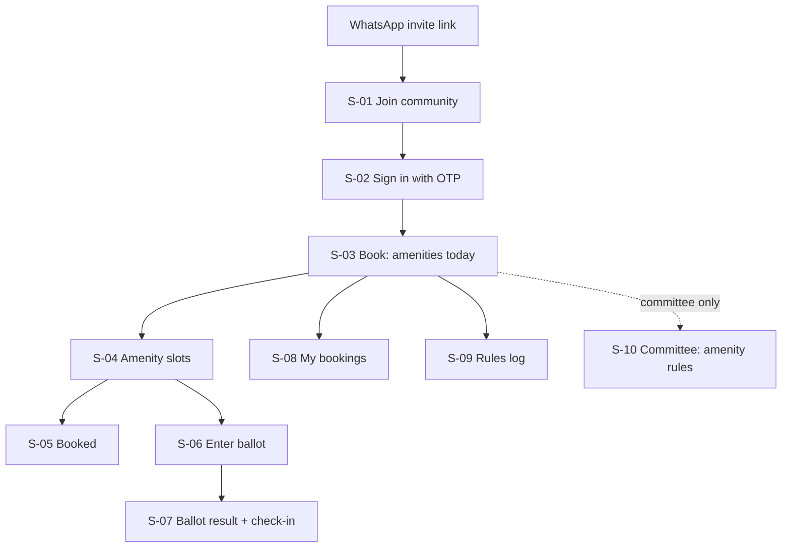
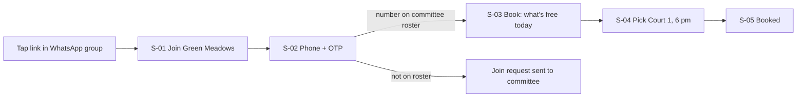
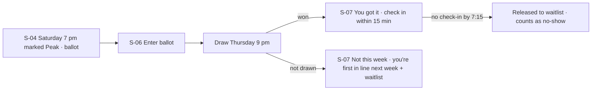
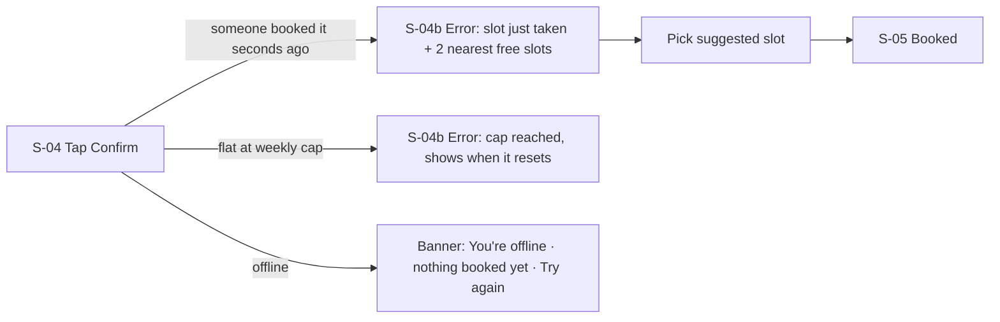

# Design Direction — ClubSlot

_Draft v0.1 · 2026-10-16 · Based on PROJECT_BRIEF v1, EVALUATION v1 (pivot: fair booking for contested amenities) · Wireframes: `design/wireframes/index.html`_

> Owner unavailable this run. Assumptions taken (logged in CLARITY.md): **web-first PWA opened from a WhatsApp link** (Q-03), **no in-app payments in v1** (Q-04), notices / visitor passes / helpdesk out of scope (Q-07). Designed for the *pivot* recommended in EVALUATION §8, not the all-in-one brief.

## 1. Summary
ClubSlot is for residents of large Hyderabad gated communities who want a fair shot at the court, pool lane or party hall, and for the volunteer committee member tired of refereeing WhatsApp. It should feel **calm, fair and quick** — like a well-run sports-club front desk, not a super-app. Recommended visual direction: **A — Courtside calm** (green-teal on warm white, large type, no ads). A returning resident books a free slot in **4 taps** from the WhatsApp link (NoBrokerHood: ~6 from app open [C7]); a peak slot is a 3-tap ballot entry.

## 2. Experience principles
| Principle | This means… | This doesn't mean… |
|---|---|---|
| Fair and visible | Every rule, ballot draw and no-show release is shown to residents in plain words (rules log) | Exposing who booked by name or phone — flat numbers only, and only to the committee |
| One job, done fast | Open link → see what's free → book, under 30 s; one primary button per screen | Adding notices, visitor passes or a feed "because incumbents have them" |
| No app, no ads | Works from a WhatsApp link in any phone browser; installable but never required; zero ads or promos | Ignoring a home-screen install for heavy users |
| Committee in control | The committee sets amenities, peak slots, caps and blackout dates; the product enforces them consistently | The product inventing rules or making silent exceptions |
| Everyone can use it | Big targets, 200 % text, simple words, works for a 67-year-old on a budget Android | A separate "senior mode" |

## 3. Competitor UX teardown
| Leader | Steps to core action | Borrow | Avoid (from review complaints) | Source |
|---|---|---|---|---|
| NoBrokerHood | App → My Society → Amenities → amenity → date/time → Book (≈ 6) | Free/booked slots visible at a glance; instant confirmation + reminder | Reschedule = cancel and rebook; phone number exposed to society | [C7][C9] |
| MyGate | App → amenity booking (exact steps not verified) | Rule set: caps per day/month, amenity groups, advance window, cancellation window, blacklist | Ad notifications ("3-4 HOAX / distracting notifications … ADS"); "Very bad ui" | [C2][C3][C6] |
| ADDA | App → Facilities → amenity → slot (not verified) | Prime slots, prime-slot caps per resident, block-only amenities | Advanced clubhouse rules locked behind a paid package; upload failures | [C10][C11] |

## 4. Information architecture
- Navigation model: **bottom tab bar with 3 tabs** (Book · My bookings · Rules) for residents — because there are only three things a resident does; committee tools sit behind a "Committee" entry visible only to committee members, opening a desktop-friendly admin layout.

## 5. Core flows
### 5.1 First run → first value

Steps to the core action: **first run 6** (link, join, OTP send, OTP enter, slot, confirm) · **returning 4** (link, amenity, slot, confirm) · leaders: ≈ 6 from app open for NoBrokerHood [C7]; MyGate/ADDA not verified.

### 5.2 The core action — book a peak slot fairly

### 5.3 Recovery path — slot taken while choosing / cap reached / offline

## 6. Screen inventory
| # | Screen | Purpose | Primary action | Key content | States | MVP? |
|---|---|---|---|---|---|---|
| S-01 | Join community | Explain what this is from the WhatsApp link | Continue with phone | Community name, 3 amenities, "no app, no ads" | loading · error (invalid/expired link) · success | MVP |
| S-02 | Sign in | Verify phone; match to flat roster | Send code / Verify | Phone, OTP, privacy line | loading · error (wrong code, not on roster → request sent) · offline | MVP |
| S-03 | Book (home) | See what's free today across amenities | Open an amenity | Next booking card, amenities with free-slot counts | loading (skeleton) · empty (no amenities set up yet) · error · offline (cached, "last updated") · success | MVP |
| S-03b | Book — first run empty | No bookings yet | Book your first slot | Short how-it-works, fair-share explainer | — | MVP |
| S-04 | Amenity slots | Pick a slot on a day | Book this slot / Enter ballot | Day picker, slot list with Free · Booked · Peak (ballot) · Closed; rules summary | loading · empty (closed today) · error · offline · success | MVP |
| S-04b | Booking error | Slot just taken / cap reached | Book suggested slot | What happened, why, 2 alternatives | — | MVP |
| S-05 | Booked | Confirm and set expectations | Add to calendar / Done | Amenity, time, check-in rule, cancel deadline | — | MVP |
| S-06 | Enter ballot | Peak-slot ballot | Enter ballot | Draw time, entrants so far, your fair-share count | loading · error · success | MVP |
| S-07 | Ballot result + check-in | Result and check-in | Check in now | Won/not drawn, check-in window, waitlist position | won · not drawn · released | MVP |
| S-08 | My bookings | Upcoming and past | Cancel booking | List with status chips | empty · loading · error · offline | MVP |
| S-09 | Rules log | Transparency | — (read) | Current rules, recent draws, releases, rule changes with date | empty · loading · error | MVP |
| S-10 | Committee: amenity rules | Configure an amenity | Save rules | Slot length, open hours, advance window, cap per flat, peak slots, blackout dates | loading · error (validation) · success | MVP |
| S-11 | Committee: residents roster | Upload/approve flats and phones | Approve join request | Pending requests, roster import (CSV) | empty · error | MVP |
| S-12 | Booking fees & payments | Collect fees | Pay by UPI | — | — | Later (Q-04) |

## 7. Content and voice
- Tone: **calm, fair, plain** — do: "You got Saturday 7 pm." · "Not drawn this week — you're first in line next week." · don't: "Oops!", "Hurry, slots filling fast!", blame ("You violated rule 4").
- Terminology: amenity → "amenity" (never "facility", "resource") · time block → "slot" · peak-slot lottery → "ballot" (never "lottery", "draw" only as verb) · residence → "flat" (never "unit", "apartment") · governing body → "committee" (never "RWA admin" in resident UI) · not showing up → "no-show".

| Moment | Copy |
|---|---|
| Onboarding promise | "Book the court, pool or hall in seconds — and get a fair shot at peak times." |
| Main empty state | "No bookings yet. Pick an amenity to see what's free today." |
| Main error | "Someone booked 6:00–7:00 pm a moment ago. 7:00 pm and 8:00 pm are still free." |
| Success moment | "Booked: Badminton Court 1, today 6:00–7:00 pm. Check in at the court by 6:15 pm or it goes to the next person." |
| Ballot not drawn | "Not drawn this week. You're first in line for next Saturday's ballot." |

## 8. Visual directions
### Option A — Courtside calm (recommended)
- Mood: calm · fresh · trustworthy
- Palette:
  | Role | Colour | On | Contrast |
  |---|---|---|---|
  | Text | #1F2A37 | #FFFFFF | 14.54:1 |
  | Text on canvas | #1F2A37 | #F7F5F0 | 13.34:1 |
  | Primary button | #FFFFFF | #0F6E5C | 6.17:1 |
  | Primary as text/link | #0F6E5C | #F7F5F0 | 5.66:1 |
  | Secondary text | #4B5563 | #F7F5F0 | 6.94:1 |
  | Error | #B42318 | #FFFFFF | 6.57:1 |
- Type: Inter (UI) / Noto Sans Telugu (later); base 17 px, line height 1.5
- Shape and spacing: 12 px radius, generous 16/24 spacing, 48 px minimum targets
- Imagery and icons: simple outlined icons (court, pool, hall); no photos needed
- Motion: 200 ms fades for confirmation; respects reduced motion
- Reference product (for feel, not to copy): a well-run sports-club booking desk; Apple Calendar's clarity
### Option B — Committee clear
- Mood: official · orderly · neutral. Navy #1B1B3A on white (16.61:1), indigo primary #4338CA with white text (7.9:1), grey #5B5B76 secondary (6.56:1). Type: IBM Plex Sans. 8 px radius, denser lists. Reads like a trusted notice board — good for committees, colder for residents.
### Option C — Festival warm
- Mood: warm · neighbourly · lively. Ink #2B2118 on cream #FFF8EE (14.93:1), terracotta primary #9A3412 with white text (7.31:1), muted #6B5E50 (5.96:1). Type: Nunito / Noto Sans. 16 px radius, illustrated empty states. Friendly for party-hall bookings; risks feeling playful during disputes.

**Recommendation and why:** A. "Fair" needs to feel calm and neutral, not bureaucratic (B) or festive (C); green-teal reads as "available / go" without relying on colour alone (every state also has a text chip). Avoid grey #8A8F98 on white for text — 3.25:1 fails.
Platform conventions to follow: **web** (responsive 360 / 768 / 1024; URLs for every slot so links can be shared in WhatsApp; browser back works), with iOS/Android touch conventions for targets.

## 9. Accessibility and inclusion plan
| Need (persona) | Design response |
|---|---|
| Mr. Rao, 67 — low vision, few apps | 17 px base, text to 200 % without overlap, no icon-only buttons, plain words, no time pressure except the check-in window (which is the committee's rule, explained up front) |
| Telugu-first residents | Strings externalised; Telugu in v1.1 (Q-06); Noto Sans Telugu line height |
| Lakshmi — one-handed, on the go | Primary action in thumb zone, 48 px targets, OTP autofill |
| Screen-reader users | Slot list as a real list; each slot announces "6 pm to 7 pm, free" / "booked" / "peak, ballot"; status never colour-only |
| Low connectivity in basements/clubhouses | Cached "what's free" with "last updated"; never show "booked" until the server confirms |
| Cognitive load | One primary action per screen; ballot explained in one sentence with "How the ballot works" link |
Floor: WCAG 2.2 AA — contrast, 44 pt / 48 dp targets, text to 200 %, screen-reader names, focus order, reduced motion.

## 10. Wireframes
- File: `design/wireframes/index.html` — open in a browser; "Prototype" mode clicks through the core flow (Join → Sign in → Book → Court slots → Booked; and Slots → Ballot → Result).
- Screens covered: S-01, S-02, S-03, S-03b, S-04, S-04b, S-05, S-06, S-07, S-08, S-09, S-10 (desktop frame) · states shown: empty (S-03b, S-08 empty note), error (S-04b, OTP error in S-02 note), offline banner (S-03), success (S-05, S-07).
- What a 5-person prototype test should check (→ validate-idea): can a first-time resident book a free slot in < 60 s; do residents understand "Peak · ballot" without help; do they trust the ballot ("is it fair?"); does a 60+ resident complete the flow at 200 % zoom; would the sports secretary accept the rules screen as the committee's rulebook.

## 11. Design decisions for the owner
| Decision | Options | Recommendation |
|---|---|---|
| Visual direction | A Courtside calm · B Committee clear · C Festival warm | A |
| Peak-slot model | Ballot · first-come-first-served with caps · both per amenity | Ballot for committee-marked peak slots, FCFS elsewhere |
| How residents join | Committee roster match · committee approves each request · open | Roster match, approval fallback |
| What residents see about others | Nothing · flat number on booked slots · names | Nothing (only "Booked"); committee sees flat numbers |

## 12. Open questions (also in CLARITY.md)
- Q-03 web vs native · Q-04 payments in v1 · Q-09 visual direction · Q-10 ballot vs FCFS · Q-11 how residents prove their flat · Q-06 Telugu at launch
