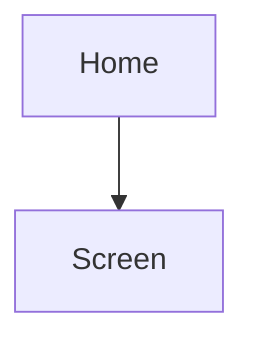
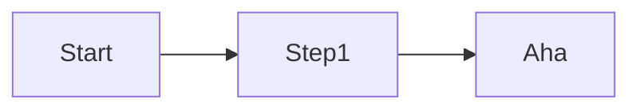

# Design Direction — {{working name}}

_Draft v{{n}} · {{date}} · Based on PROJECT_BRIEF v{{n}}, EVALUATION v{{n}} · Wireframes: `design/wireframes/index.html`{{ · Figma: link}}_

## 1. Summary
{{3–4 sentences: who it's for, the feeling, the recommended visual direction, and how fast a new user reaches the core action (vs the leaders).}}

## 2. Experience principles
| Principle | This means… | This doesn't mean… |
|---|---|---|
| | | |

## 3. Competitor UX teardown
| Leader | Steps to core action | Borrow | Avoid (from review complaints) | Source |
|---|---|---|---|---|

## 4. Information architecture
- Navigation model: {{tabs / sidebar / single flow}} — because {{reason}}

## 5. Core flows
### 5.1 First run → first value

Steps to the core action: {{n}} (leaders: {{n}})
### 5.2 The core action
### 5.3 Recovery path ({{error / offline / permission denied}})

## 6. Screen inventory
| # | Screen | Purpose | Primary action | Key content | States | MVP? |
|---|---|---|---|---|---|---|
| S-01 | | | | | empty · loading · error · offline · success | MVP |

## 7. Content and voice
- Tone: {{3 words}} — do: … · don't: …
- Terminology: {{concept}} → "{{word}}" (never "{{alternative}}")
| Moment | Copy |
|---|---|
| Onboarding promise | |
| Main empty state | |
| Main error | |
| Success moment | |

## 8. Visual directions
### Option A — {{name}} (recommended)
- Mood: {{3 words}}
- Palette:

  | Role | Colour | On | Contrast |
  |---|---|---|---|

- Type: {{display}} / {{text}}; base size {{n}}
- Shape and spacing: {{radius, density}}
- Imagery and icons:
- Motion:
- Reference product (for feel, not to copy):
### Option B — {{name}}
### Option C — {{name}} (optional)
**Recommendation and why:**
Platform conventions to follow: {{HIG / Material 3 / web}}

## 9. Accessibility and inclusion plan
| Need (persona) | Design response |
|---|---|
Floor: WCAG 2.2 AA — contrast, 44 pt / 48 dp targets, text to 200 %, screen-reader names, focus order, reduced motion.

## 10. Wireframes
- File: `design/wireframes/index.html` — open in a browser; "Prototype" mode clicks through the core flow.
- Screens covered: {{list}} · states shown: {{empty, error…}}
- What a 5-person prototype test should check (→ validate-idea):

## 11. Design decisions for the owner
| Decision | Options | Recommendation |
|---|---|---|

## 12. Open questions (also in CLARITY.md)
-
